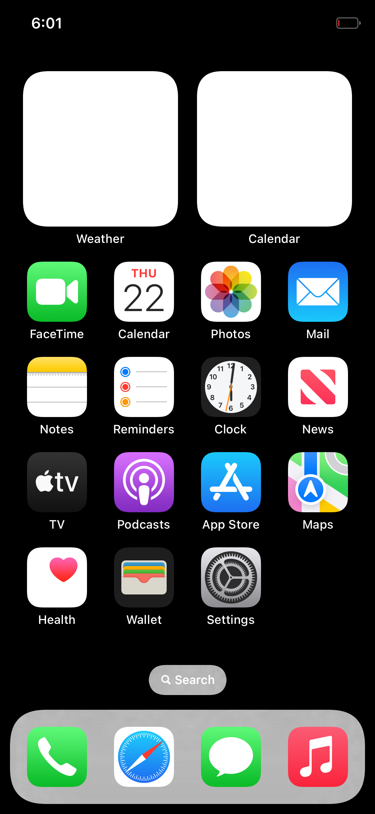

# Getting HackiOS to a drawn screen in QEMU

What a working QEMU session looks like, what it costs, and the two things that stopped it
before it worked. Measured on QEMU 8.2.2 (Debian/Ubuntu), aarch64 `virt`, pure TCG, 8 host cores.

## Host requirements

| | |
|---|---|
| guest RAM | `QEMU_RAM_GB=7` (the profile's default, `common/devices/qemu-virt.conf`) |
| swap | **6 GB, and without it the run is OOM-killed** |
| wall clock | 20 minutes: the lock screen does not appear in 15 |
| disk | ~2.5 GB for `system.apfs`, plus the swap file |

`QEMU_RAM_GB=7` is what gives the kernel the same 4.2 GB window it has on the phone. On a
7.9 GB host that only fits because QEMU's own memory can be paged out: measured with 6 GB of
swap, `MemAvailable` sits at ~1.5 GB through the run and swap stays at 0. **Without swap the
same boot dies** -- the guest is killed (`run.sh: ... Killed`) a few seconds after SpringBoard
starts, having reported `available 654 MB` of its own. At 6 GB of guest RAM the kernel has only
~460 MB available and spends the session close to its own low-water kill thresholds.

## Two bugs that made it look like a dead display

### 1. `ramfb`: the DMA control word was never read back

`ramfb_phone_screen()` (`xnuloader/loader.c`) asks QEMU, through the fw_cfg DMA interface, to
point ramfb at a buffer of the phone's size. The `dma` struct was not `volatile`, so the
compiler reused the value it had just stored instead of loading the one QEMU writes back, and
the `dma.control != 0` test was always true:

    ramfb: control 250018 after the request     <- 0x25 << 16 | 0x18: its own value, not QEMU's
    display 800 x 600 at 1bc7a0000              <- the firmware's mode, never replaced

Fixed (commit `e60b7cb`) by making `control` volatile. The same boot then reports
`display 1125 x 2436 at ...` and `MiniIOMobileFramebuffer: ... panel of 1125x2436`.

**Symptom to recognise**: `display 800 x 600` in the loader's first lines. iOS then draws
1125x2436 frames into a buffer the display never shows, and the screen stays black however long
you wait. On this host the missing `vgabios-ramfb.bin` that QEMU also complains about is a red
herring: it is a 16-bit x86 option ROM that never executes on aarch64, and the complaint is a
warning -- the boot runs to completion without it. (`apt-get install seabios` and copy
`vgabios-ramfb.bin` into `/usr/share/qemu/` if the noise is unwanted.)

### 2. SpringBoard's own log is discarded by default

`userland/build.sh` sets `OSLOG=${OSLOG-com.apple.backboardd}`, so only backboardd gets
`OS_ACTIVITY_DT_MODE=YES` and SpringBoard's `os_log` output goes nowhere. A SpringBoard that is
working hard looks exactly like one that is stuck.

    OSLOG="all com.apple.SpringBoard" ./userland/build.sh     # rebuilds root.apfs: 4 MB, seconds

The launchd job plists live in **`root.apfs`** (`build.sh:635`), not in `system.apfs`
(`build.sh:831`), so this does not cost a 2.5 GB rebuild. Check the result from inside the image:

    python3 tools/apfs/apfs.py cat userland/root.apfs /LaunchDaemons/com.apple.SpringBoard.plist

## What the session actually does

Do not read silence as a hang. First boot is `lsd` creating a container per bundle, about
**0.7 bundles per second** on this host, ~700 in the image:

    Made container live for com.apple.tv

That is ~16 minutes of the 20 before SpringBoard draws anything, and it looks like a log full of
`usermanagerd`/`containermanagerd` errors. Judge progress by several indicators at once --
`Made container live` count, QEMU's cpu time, `MiniIOMobileFramebuffer: swap` count, and the
screenshot -- never by one counter sitting still.

A run that worked, in order: `display 1125 x 2436` -> `platform qemu-virt` -> kernel ->
launchd -> `Presenting overlay: BKDisplayRenderOverlayAppleLogo` -> 662 containers ->
SpringBoard `[homescreen]` -> `swap 1..17` -> the home screen, drawn:

Status bar, both widgets, every icon drawn from its real asset, the dock, the search pill.
The two widgets are white because their contents are drawn by a GPU extension and this is the
software renderer -- `redwood: no accelerated renderer; the software one will draw`, which is
the injection library's intended path in QEMU, not a fault.

## Why the home screen and not the lock screen

iOS 16 draws the lock screen through `com.apple.posterboardservices`. Its publisher is
`com.apple.PosterBoard` -- and that is not a LaunchDaemon but a **LaunchAngel**.

`build.sh` deletes `System/Library/LaunchAngels` and points `LaunchDaemons` at our own directory,
so all twelve angels are off the volume launchd reads. Naming one in `IOS_JOBS` used to fail
outright, because `mkjobs.py` only ever opened `LaunchDaemons/<label>.plist`. It now falls back to
`LaunchAngels/<label>.plist` for a label that is named explicitly -- an angel is still only ever
run when something asks for one of its Mach services, which is what naming it is for.

With `com.apple.PosterBoard` named:

* `Successfully spawned PosterBoard[38] because launch job`, and it goes on to start
  `com.apple.WallpaperKit.CollectionsPoster` (397 lines of wallpaper machinery);
* the `failed lookup: name = com.apple.posterboardservices` warnings (3 of them) drop to **0**;
* nothing regresses -- 662 containers, 17 swaps, and the home screen is still drawn.

The screen is still the home screen, so resolving the service was necessary but not sufficient:
SpringBoard does not enter the lock-screen state on this boot. The next thing to look at is what
else the lock screen needs before `SBLockScreenManager` commits to it.

The twelve angels, and what each draws a part of, so the next person knows what is missing:

| angel | what it is |
|---|---|
| `com.apple.PosterBoard` | the lock screen / posters (`posterboardservices`) |
| `com.apple.PaperBoard` | the wallpaper |
| `com.apple.InputUI` | the keyboard |
| `com.apple.MediaRemoteUI` | the now-playing controls |
| `com.apple.ClockAngel` | the clock |
| `com.apple.AccessibilityUIServer` | accessibility overlay |
| `com.apple.UIKit.OverlayUI` | UIKit overlay windows |
| `com.apple.PassbookUISceneService` | Wallet scenes |
| `com.apple.ShortcutsUI` | Shortcuts scenes |
| `com.apple.livetranscriptionui` | live transcription |
| `com.apple.replaykitangel` | ReplayKit |
| `com.apple.sharing.airdropui` | AirDrop UI |

Note also that the home screen is the *stronger* result than the lock screen: it means
SpringBoard, icon services, the icon layout and the dock all work.
