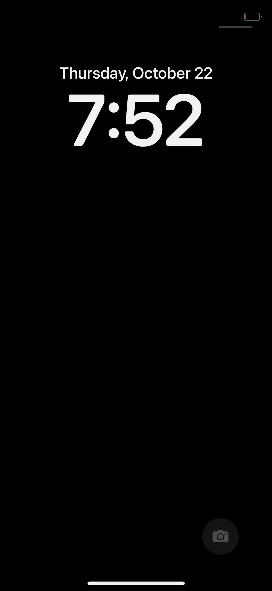

# Getting HackiOS to a drawn screen in QEMU

What a working QEMU session looks like, what it costs, and the two things that stopped it
before it worked. Measured on QEMU 8.2.2 (Debian/Ubuntu), aarch64 `virt`, pure TCG, 8 host cores.

## Host requirements

| | |
|---|---|
| guest RAM | `QEMU_RAM_GB=7` (the profile's default, `common/devices/qemu-virt.conf`) |
| swap | 6 GB recommended; see below |
| wall clock | 20 minutes: the home screen does not appear in 15 |
| disk | ~2.5 GB for `system.apfs`, plus the swap file |

`QEMU_RAM_GB=7` is what gives the kernel the same 4.2 GB window it has on the phone, and it is
what the runs that reached the home screen used. On a 7.9 GB host that only fits because QEMU's
own memory can be paged out: with 6 GB of swap, `MemAvailable` sits at ~1.5 GB through the run
and the host's swap stays unused.

The guest's own headroom is the number that moved: at `QEMU_RAM_GB=6` it reported `available`
around **460 MB** and `free 7 MB` for most of the session; at 7 GB it reports about **1357 MB**.
That is the measurement this recommendation rests on.

**Honest limit of the evidence**: an earlier 6 GB boot without swap did end shortly after
SpringBoard started, and I first wrote that down as an OOM kill. It is not proven -- that log has
since been overwritten, and `dmesg` (whose ring does cover the period) contains no OOM record at
all. What is established is the comparison above and that every run which reached a drawn screen
used 7 GB with swap available. Treat "you need swap" as a sensible precaution with a plausible
mechanism, not as a measured fact.

## Two bugs that made it look like a dead display

### 1. `ramfb`: the DMA control word was never read back

`ramfb_phone_screen()` (`xnuloader/loader.c`) asks QEMU, through the fw_cfg DMA interface, to
point ramfb at a buffer of the phone's size. The `dma` struct was not `volatile`, so the
compiler reused the value it had just stored instead of loading the one QEMU writes back, and
the `dma.control != 0` test was always true:

    ramfb: control 250018 after the request     <- 0x25 << 16 | 0x18: its own value, not QEMU's
    display 800 x 600 at 1bc7a0000              <- the firmware's mode, never replaced

Fixed (commit `e60b7cb`) by making `control` volatile. The same boot then reports
`display 1125 x 2436 at ...` and `MiniIOMobileFramebuffer: ... panel of 1125x2436`.

**Symptom to recognise**: `display 800 x 600` in the loader's first lines. iOS then draws
1125x2436 frames into a buffer the display never shows, and the screen stays black however long
you wait. On this host the missing `vgabios-ramfb.bin` that QEMU also complains about is a red
herring: it is a 16-bit x86 option ROM that never executes on aarch64, and the complaint is a
warning -- the boot runs to completion without it. (`apt-get install seabios` and copy
`vgabios-ramfb.bin` into `/usr/share/qemu/` if the noise is unwanted.)

### 2. SpringBoard's own log is discarded by default

`userland/build.sh` sets `OSLOG=${OSLOG-com.apple.backboardd}`, so only backboardd gets
`OS_ACTIVITY_DT_MODE=YES` and SpringBoard's `os_log` output goes nowhere. A SpringBoard that is
working hard looks exactly like one that is stuck.

    OSLOG="all com.apple.SpringBoard" ./userland/build.sh     # rebuilds root.apfs: 4 MB, seconds

The launchd job plists live in **`root.apfs`** (`build.sh:635`), not in `system.apfs`
(`build.sh:831`), so this does not cost a 2.5 GB rebuild. Check the result from inside the image:

    python3 tools/apfs/apfs.py cat userland/root.apfs /LaunchDaemons/com.apple.SpringBoard.plist

## What the session actually does

Do not read silence as a hang. First boot is `lsd` creating a container per bundle, about
**0.7 bundles per second** on this host, ~700 in the image:

    Made container live for com.apple.tv

That is ~16 minutes of the 20 before SpringBoard draws anything, and it looks like a log full of
`usermanagerd`/`containermanagerd` errors. Judge progress by several indicators at once --
`Made container live` count, QEMU's cpu time, `MiniIOMobileFramebuffer: swap` count, and the
screenshot -- never by one counter sitting still.

A run that worked, in order: `display 1125 x 2436` -> `platform qemu-virt` -> kernel ->
launchd -> `Presenting overlay: BKDisplayRenderOverlayAppleLogo` -> 662 containers ->
SpringBoard `[homescreen]` -> `swap 1..17` -> the home screen, drawn:


Status bar, both widgets, every icon drawn from its real asset, the dock, the search pill.

The two widgets are white because nothing ever filled them in, and the reason is in the log, not
in the renderer:

    lsd: Failed to fetch app bundle unit: 0 for extension point: com.apple.widget-extension

No widget extension process is ever spawned (`Successfully spawned` never matches a widget bundle),
so there is no content to draw. That is not the accelerated-renderer path being absent --
scripts still run and the dock and icons are drawn -- it is widget *discovery* failing, and it is
the next thing to look at. (The software renderer message
`redwood: no accelerated renderer; the software one will draw` is the injection library's intended
path in QEMU, and it is not the cause of the blank widgets.)

## The lock screen: it is there, and the boot-arg that keeps it

The lock screen is reached, but by default it is **dismissed after ten seconds**, by design and by
our own code. `src/inject_sb.c` (userland) forces an unlock ten seconds after SpringBoard starts:

    /* ... if touch is still probing, has failed, or the panel is a FocalTech and the firmware
       upload is still chewing through ~114 KB of SPI ... the user ends up staring at a dark lock
       screen with nothing to swipe. So we just forcibly dismiss it after 10 seconds so iOS always
       lands on the home screen even in the worst case. */
    dispatch_after(..., 10 * NSEC_PER_SEC, ..., ^{ unlock(); });

So the lock screen *is* shown first. What proves it ran is the unlock call itself: `unlock()`
(`inject_sb.c`) reports which of its three cases it took, and in the default boot it printed
`redwood: unlock: asked, answer 1` -- not `not locked`. `isUILocked` was YES, and
`unlockUIFromSource:` then succeeded. The home screen is what that unlock leaves behind.

`autounlock=0` is the upstream switch for keeping it (its comment: "to show the phone starting
the way an iPhone does"):

```sh
CMDLINE="cpus=4 autounlock=0" ./qemu/run-ios.sh 1200
```



Date, large clock, battery, the camera button and the home bar. To tell whether it worked, look
for `redwood: the lock screen stays until it is swiped away (autounlock=0)` and for the *absence*
of `redwood: unlock: asked, answer 1`.

**Searching the log for `SBLockScreenManager` finds nothing either way**: it does not write
`os_log`, only the injection library's `say()` mentions it. Do not read its absence as "the lock
screen never happened".

## Four things that cost the most time

Every one of these is a mistake that was actually made while getting this far, not advice
written afterwards.

**1. A warning going away is not a fix.** QEMU complains `Could not open option rom
'vgabios-ramfb.bin'` on every boot. Installing `seabios` and copying the file silences it -- and
changes nothing about whether the screen is drawn, because the ROM is a 16-bit x86 option ROM
that never executes on aarch64. The real fault was the missing `volatile` (above), and the
symptom that actually identifies it is the loader printing `display 800 x 600`. Choose a
judgement that can be false: "the display is 1125x2436", not "the error is gone".

**2. Silence is not a hang, and it is also not an absence.** First boot spends ~16 minutes in
`lsd` making containers; the log is a wall of `usermanagerd` and `containermanagerd` errors and
nothing that looks like progress. Judge by several indicators at once -- container count, QEMU's
cpu time, the swap counter, a screenshot -- never by one counter sitting still. The converse bit
just as hard: `SBLockScreenManager` appears **nowhere** in the log whether or not the lock screen
happened, because it writes no `os_log`. A log tells you what happened; it cannot tell you what
did not.

**3. Observing something, plus a mechanism that explains it, is not a cause.** An earlier 6 GB
boot ended shortly after SpringBoard started, and the memory numbers made "OOM killed" an
obvious reading -- right up until `dmesg`, whose ring did cover that moment, turned out to hold
no OOM record at all. The `Killed` lines in the surviving logs are launchd killing *guest*
processes, which is a different thing entirely. The useful move was not finding contrary evidence
but asking "if this were true, what should be here?" and looking for exactly that.

**4. Check the artefact, not the process that made it.** `screendump.sh` reported a missing file
for a screenshot QEMU had written correctly, because it named the PPM after the PNG. A tool that
quietly misreports is worse than one that fails. When it matters, read the result back out of the
image or the file: the job list was verified by

    python3 tools/apfs/apfs.py cat userland/root.apfs /LaunchDaemons/com.apple.SpringBoard.plist

rather than by trusting that `mkjobs.py` had run.

## PosterBoard: a real bug, but not the reason there was no lock screen

This was checked before the above was found, and it corrected a wrong first guess, so it is kept.
`com.apple.posterboardservices` is published by `com.apple.PosterBoard` -- which is not a
LaunchDaemon but a **LaunchAngel**.

`build.sh` deletes `System/Library/LaunchAngels` and points `LaunchDaemons` at our own directory,
so all twelve angels are off the volume launchd reads. Naming one in `IOS_JOBS` used to fail
outright, because `mkjobs.py` only ever opened `LaunchDaemons/<label>.plist`. It now falls back to
`LaunchAngels/<label>.plist` for a label that is named explicitly -- an angel is still only ever
run when something asks for one of its Mach services, which is what naming it is for.

With `com.apple.PosterBoard` named:

* `Successfully spawned PosterBoard[38] because launch job`, and it goes on to start
  `com.apple.WallpaperKit.CollectionsPoster` (397 lines of wallpaper machinery);
* the `failed lookup: name = com.apple.posterboardservices.services` warnings drop from **2 to 0**
  (counted, not guessed: `grep -c` on the two runs);
* nothing regresses -- 662 containers, 17 swaps, and the home screen is still drawn.

PosterBoard is therefore *not* what kept the lock screen away -- the ten-second unlock was (see
above), and the lock screen appears in a boot where PosterBoard is absent. The fix is still right
on its own terms: those twelve jobs could not be asked for at all, and three failed lookups a
session is a real defect.

The twelve angels, and what each draws a part of, so the next person knows what is missing:

| angel | what it is |
|---|---|
| `com.apple.PosterBoard` | the lock screen / posters (`posterboardservices`) |
| `com.apple.PaperBoard` | the wallpaper |
| `com.apple.InputUI` | the keyboard |
| `com.apple.MediaRemoteUI` | the now-playing controls |
| `com.apple.ClockAngel` | the clock |
| `com.apple.AccessibilityUIServer` | accessibility overlay |
| `com.apple.UIKit.OverlayUI` | UIKit overlay windows |
| `com.apple.PassbookUISceneService` | Wallet scenes |
| `com.apple.ShortcutsUI` | Shortcuts scenes |
| `com.apple.livetranscriptionui` | live transcription |
| `com.apple.replaykitangel` | ReplayKit |
| `com.apple.sharing.airdropui` | AirDrop UI |

Note also that the home screen is the *stronger* result than the lock screen: it means
SpringBoard, icon services, the icon layout and the dock all work.
